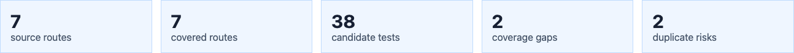

# Playwright Agent

AI coding agents can now write Playwright tests quickly. Playwright Agent answers
the questions that remain once they have:

1. **Do the tests cover the intended acceptance criteria?** Requirements from
   tickets, epics, PRDs and RTM exports become source-linked criteria; each one
   is checked against the actual test bodies and assertions, not test names.
2. **Is the traceability matrix complete?** Criteria map to scenario, test,
   assertion and runtime evidence, with gaps and unknowns kept visible.
3. **Do the assertions actually catch defects?** Reviewed behavioral faults run
   against the real application in disposable copies; a fault the suite misses
   is a concrete test gap.

Use your existing coding agent, project and test framework.
**New here? Follow the [step-by-step onboarding guide](docs/getting-started.md).**
Repository: [balajiregt/playwright-agent](https://github.com/balajiregt/playwright-agent).

## Start with your prompt

Use $playwright-agent in your coding chat, or select Playwright Agent in Copilot.
The router reads your request and exclusions, then loads only the relevant skill.

| Request | Workflow |
| --- | --- |
| Create, edit, fix or execute tests | Test authoring → focused project checks → report |
| Assess acceptance criteria, test matrices, gaps or duplicates | Explicit assessment → evidence-linked findings → report |
| Verify assertion sensitivity using application faults | Explicit mutation verification → activation/execution/restoration evidence → report |
| Create tests and run mutation verification | Authoring → healthy tests → frozen-test mutation campaign → report |

Ordinary test changes do not trigger formal assessment, a traceability matrix,
mutation testing or extra models. Run-only requests do not authorize repairs.
Assessment-only work leaves source/tests unchanged and executes checks only when
requested. Nonfunctional testing is outside this agent's scope.

Examples:

- "Create the missing login tests from this ticket. Run the focused suite."
- "Fix this locator using the existing page object. No assessment or mutation."
- "Assess these tests against the acceptance criteria; do not change or run them."
- "Run mutation verification for this reviewed fault plan; keep tests unchanged."

Judgments are made by your coding agent's current model; no extra model, API key
or hosted provider is used. [Routing and prompts](docs/playwright-agent.md) ·
[Canonical router](.agents/skills/playwright-agent/SKILL.md).

## Configure an existing project once

Keep this clone or extracted source ZIP as a local toolkit. Your tests,
configuration, page objects and fixtures stay in the adopting repository.

~~~sh
npm ci
npm ci --prefix quality
npm run agent:configure -- --repo /path/to/your-playwright-project --client both
~~~

The target must already declare @playwright/test and contain a Playwright config.
Use --playwright-config for another existing config path. Onboarding creates
project-local skill shims and/or a Copilot entrypoint, plus an ignored relative
toolkit configuration. It does not install a framework, select a task, run tests,
or overwrite conflicting files. Existing adopters must review changed shims
before replacing them; reconfiguration never overwrites them. Restart the client
session to refresh discovery. [Adoption and setup](docs/adoption.md).

Then add the evidence reporter beside your existing reporters, so every run is
saved and the HTML report is rebuilt:

~~~ts
reporter: [['list'], ['../playwright-agent/reporter/index.mjs', { task: 'LOGIN-123' }]],
~~~

## Supply only the context needed

A clear prompt or selected requirement file needs no task card or intake UUID.
For a larger ticket, keep private inputs in the target project's
contexts/tasks/WORK-ITEM/ folder. Attach supporting documents in chat when the
host exposes their local files or text.

Use [document intake](docs/document-intake.md) when PDFs, Jira exports or
spreadsheets need extraction and source-linked interpretation. The agent handles
structured formatting; the tester reviews ambiguities and any exact normalized
interpretation before acceptance. Intake is not a mandatory authoring phase.

For a focused check of whether one test's assertion proves one criterion, use
[requirement-to-assertion claims](docs/claim-evidence.md) (`npm run claims`).

## Inspect saved outcomes

The reporter attaches each Playwright run automatically. Save findings or a
mutation campaign, then rebuild the report:

~~~sh
npm run portal -- analysis --repo /path/to/your-project --task LOGIN-123 --file /path/to/findings.md
npm run portal -- attach --repo /path/to/your-project --task LOGIN-123 --kind mutation --file /path/to/campaign.json
npm run report -- --repo /path/to/your-project [--task LOGIN-123] [--serve]
~~~

`report` writes a self-contained `playwright-agent-report/index.html` (private,
Git-ignored); `--serve` also opens the local read-only viewer. For an existing
intake interpretation, add --run UUID to bind assessment findings to that exact
version. The viewer cannot upload, edit, approve or execute work.
[Report viewer](docs/portal.md).

## Harness conventions and optional discovery

Reuse the target's framework layers, auth setup and helpers. Prefer semantic
locators, web-first assertions, focused changes and actual execution evidence.
The original [harness guide](docs/agent-workflow.md) covers specs, captures,
page objects, fixtures, debugging and evidence. MCP and official Playwright
agents are optional tool choices after task routing.

Source/test/coverage/duplicate graphs support requested discovery or broad flow
planning; they are suggestions, not proof of acceptance. Existing sample graph
commands use the CRM adapter. Configure the generic scanner or your own source
manifest for a different application; do not run the sample as project validation.

~~~sh
npm run source:manifest -- --root=/path/to/app --output=source-manifest.json
~~~

For the bundled CRM demonstration, npm run graph:view refreshes its sample
manifest and graphs. External projects must select their own manifest and sync
configuration as described in the harness guide.

## Quality tools

- [Quality module](quality/README.md): intake, claim checks, behavioral mutation runner and report viewer.
- [Mutation workflow](quality/docs/behavioral-mutations.md): trusted local JS/TS targets, selected faults and configured probes; not universal application support.
- [Optional integrations](.agents/skills/playwright-agent/references/integrations.md): claim checks and the mutation runner's CLI/MCP tools.
- [Evaluation reports](docs/evaluation-reports.md): inspectable rule/expected/observed scorecards for proving the workflow on your own tasks.
- [Synthetic demo](examples/validation-demo/README.md): mutation verification on the bundled sample CRM, separate from daily authoring.

The source ZIP includes the skills and public synthetic CRM-DEMO-001 documents,
and excludes private tasks, credentials, dependencies and generated local reports.
